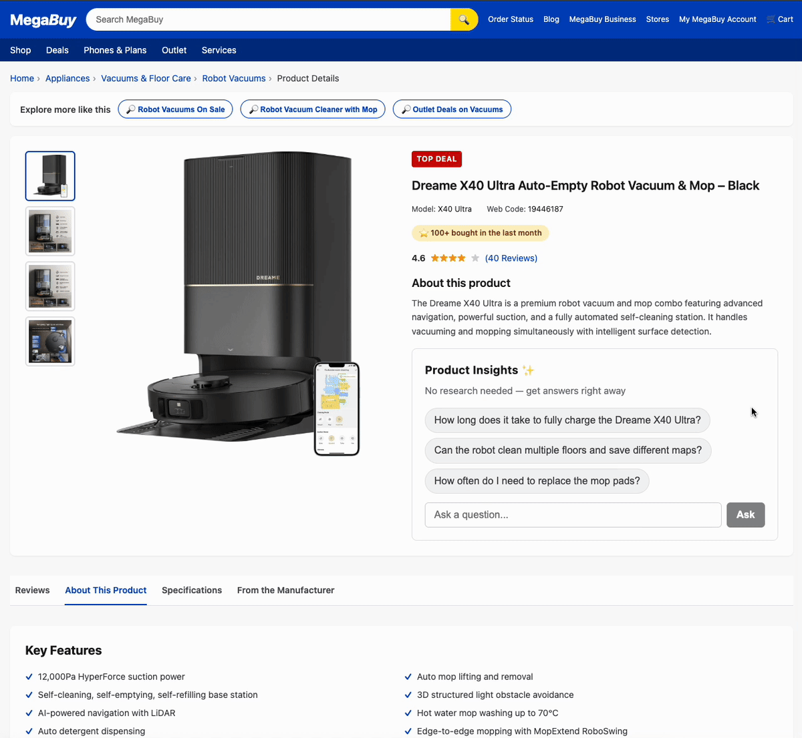

# Product Insights Agent

<p align="center">
  
</p>

<p align="center"><em>A shopper asks a product question on the PDP — the agent answers, grounded in the manual, in under a second.</em></p>

**A reference architecture for an expert product sales assistant:**

- A **conversational widget** that drops onto any retailer's PDP and answers shopper questions grounded in that product's own documentation
- Retrieval runs on a **vector store built with eval-driven chunking, contextual enrichment, and LLM-judged quality gates** — the context the agent reasons over is measurably high-quality before a single customer sees it
- Every request flows through a **four-layer guardrails stack** mapped to the [OWASP LLM Top 10](https://genai.owasp.org/llm-top-10/) — three of the four layers are deterministic on purpose
- **Traced end-to-end in LangSmith**

This repo is split into two sibling Next.js applications that together show the full integration story: the widget itself — bundle, embed loader, chat API, retrieval, guardrails, observability, and a dev control panel — and a minimal example storefront that embeds it the same way a real adopter would, via a one-line `<script>` tag and a cross-origin sandboxed iframe. The storefront is deliberately not special; it exists to prove the widget is a true third-party drop-in.

- **[`product-insights-agent/`](./product-insights-agent/README.md)** — the product. Widget bundle, `embed.js` loader, streaming chat API, RAG pipeline, guardrails, evals, and control panel. Runs on `http://localhost:3000`.
- **[`storefront/`](./storefront/app/page.tsx)** — the example retailer PDP. A single-page Next.js app that loads the widget via `<script src=".../embed.js">`. Runs on `http://localhost:3001`.

## 📦 Embed the widget in one tag

The whole point of this project: **a retailer drops one `<script>` tag onto a product page and the widget mounts as a sandboxed iframe.** No framework, no build step, no CSS or JS leakage between the widget and the host page.

```html
<div id="product-insights"></div>
<script
   src="https://your-deployment.vercel.app/embed.js"
   data-product-id="dreame-x40-ultra"
   data-mount="#product-insights"
></script>
```

- **Full integration guide (required reading for adopters)** → [`product-insights-agent/docs/widget-injection.md`](./product-insights-agent/docs/widget-injection.md)
- **Working example (a real storefront doing exactly this)** → [`storefront/app/page.tsx`](./storefront/app/page.tsx) — the `<Script src="…/embed.js">` block around line 157 is the whole integration.

## Run it

See [`QUICKSTART.md`](./QUICKSTART.md) for the full setup: installing both apps, configuring env vars, populating the vector store, and running the widget app and example storefront together.

## Where to go next

- Widget architecture, ingestion pipeline, evals, deployment — see [`product-insights-agent/README.md`](./product-insights-agent/README.md).
- Storefront is intentionally minimal — the whole PDP lives in [`storefront/app/page.tsx`](./storefront/app/page.tsx).
- To point the storefront at a deployed widget, set `NEXT_PUBLIC_WIDGET_ORIGIN` in `storefront/.env.local`.
